<picture><source media="(prefers-color-scheme: dark)" srcset="assets/hero-dark.svg"></picture>

<picture><source media="(prefers-color-scheme: dark)" srcset="assets/social-l-dark.svg"></picture><a href="https://t.me/samsepi0l_ovf"><picture><source media="(prefers-color-scheme: dark)" srcset="assets/social-1-dark.svg"></picture></a><picture><source media="(prefers-color-scheme: dark)" srcset="assets/social-r-dark.svg"></picture>

<picture><source media="(prefers-color-scheme: dark)" srcset="assets/about-dark.svg"></picture>

<picture><source media="(prefers-color-scheme: dark)" srcset="assets/stack-dark.svg"></picture>

<a href="https://github.com/sepiol026-wq/telegram-id-age-research"><picture><source media="(prefers-color-scheme: dark)" srcset="assets/project-telegram-id-age-research-dark.svg"></picture></a>&nbsp;<a href="https://github.com/sepiol026-wq/GhGoyifier"><picture><source media="(prefers-color-scheme: dark)" srcset="assets/project-ghgoyifier-dark.svg"></picture></a>

<a href="https://github.com/sepiol026-wq/GoyModules"><picture><source media="(prefers-color-scheme: dark)" srcset="assets/project-goymodules-dark.svg"></picture></a>&nbsp;<a href="https://github.com/sepiol026-wq/vector-frontend"><picture><source media="(prefers-color-scheme: dark)" srcset="assets/project-vector-frontend-dark.svg"></picture></a>

<picture><source media="(prefers-color-scheme: dark)" srcset="assets/stats-dark.svg"></picture>

<picture><source media="(prefers-color-scheme: dark)" srcset="assets/streak-dark.svg"></picture>

<picture><source media="(prefers-color-scheme: dark)" srcset="assets/wave-dark.svg"></picture>

<a href="https://www.0xvector.lol"><picture><source media="(prefers-color-scheme: dark)" srcset="assets/button-1-dark.svg"></picture></a>&nbsp;&nbsp;<a href="https://github.com/GoyGram/GoyGram"><picture><source media="(prefers-color-scheme: dark)" srcset="assets/button-2-dark.svg"></picture></a>&nbsp;&nbsp;<a href="https://github.com/HotaruProject/Hotaru"><picture><source media="(prefers-color-scheme: dark)" srcset="assets/button-3-dark.svg"></picture></a>&nbsp;&nbsp;<a href="https://github.com/sepiol026-wq?tab=repositories"><picture><source media="(prefers-color-scheme: dark)" srcset="assets/button-4-dark.svg"></picture></a>

<a href="https://metawka.github.io/expressive-profile/?from=sepiol026-wq"><picture><source media="(prefers-color-scheme: dark)" srcset="assets/credit-dark.svg"></picture></a>

